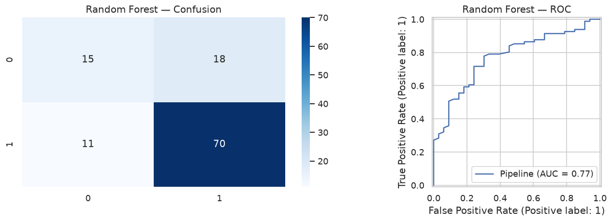
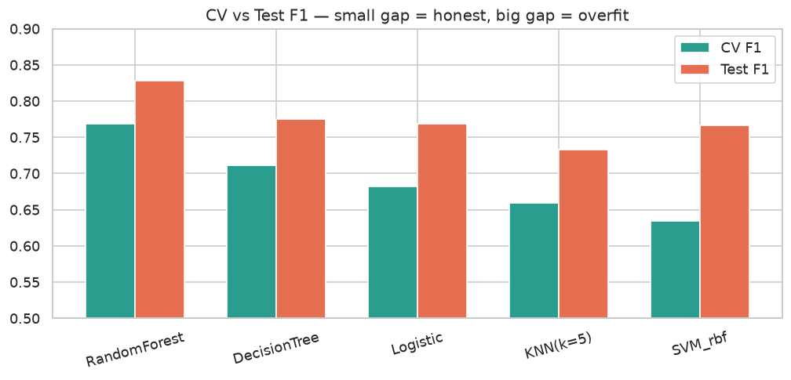

# Liver Patient Records Classification

This project builds and compares multiple machine learning classification models to predict whether a patient is likely to have **liver disease** based on clinical and demographic measurements.

The project uses the **Indian Liver Patient Dataset (ILPD)**, a small tabular medical dataset containing liver function test results, age, and gender. The goal is not to create a clinical diagnostic system, but to study how different machine learning algorithms perform on the same medical classification problem.

The complete workflow covers:

1. Loading and inspecting the raw patient data
2. Cleaning the dataset and handling missing values
3. Exploring relationships between clinical measurements
4. Preparing features for machine learning
5. Handling class imbalance using SMOTE
6. Training multiple classification algorithms
7. Evaluating models using cross validation and a held out test set
8. Comparing model performance under the same preprocessing strategy
9. Identifying the strengths, weaknesses, and appropriate use cases of each model

A major focus of the project is **preventing data leakage**. Imputation, scaling, and SMOTE are performed inside the machine learning Pipeline so that these operations are fitted only on the training data.

The project therefore demonstrates not only which model performs best, but also how to build a fair and reproducible machine learning evaluation workflow.

## Observation

No single model wins everywhere.

Logistic Regression provides a useful linear baseline, Decision Trees are relatively easy to interpret, KNN is simple but depends heavily on feature scaling, and SVM can model more flexible decision boundaries.

Random Forest proved to be the most reliable model in this experiment. By combining predictions from multiple decision trees, it provides more stable performance than relying on a single tree.

The final comparison is based on giving the models the same preprocessing, train/test split, class balancing strategy, and evaluation procedure.

### Best Model: Random Forest

Random Forest achieved approximately **CV F1 ~0.77** and **Test F1 ~0.83** in the experiment.



## Dataset

The project uses the **Indian Liver Patient Dataset (ILPD)**.

The records contain clinical measurements collected from patients in the **North East of Andhra Pradesh, India**. The dataset was originally used to evaluate prediction algorithms for liver disease classification, with the broader motivation of exploring methods that could potentially help reduce the workload involved in medical assessment.

The original dataset contains **583 patient records**:

| Category         | Records |
| ---------------- | ------: |
| Liver disease    |     416 |
| No liver disease |     167 |
| Male             |     441 |
| Female           |     142 |
| Total            |     583 |

The target column is `Dataset`.

| Dataset value | Meaning          |
| ------------- | ---------------- |
| `1`           | Liver disease    |
| `2`           | No liver disease |

This produces an approximately **71:29 class distribution**, making the dataset imbalanced.

### Features

The dataset contains the following patient attributes:

| Feature                      | Description                      |
| ---------------------------- | -------------------------------- |
| `Age`                        | Age of the patient               |
| `Gender`                     | Gender of the patient            |
| `Total_Bilirubin`            | Total bilirubin level            |
| `Direct_Bilirubin`           | Direct bilirubin level           |
| `Alkaline_Phosphotase`       | Alkaline phosphatase level       |
| `Alamine_Aminotransferase`   | Alamine aminotransferase level   |
| `Aspartate_Aminotransferase` | Aspartate aminotransferase level |
| `Total_Protiens`             | Total protein level              |
| `Albumin`                    | Albumin level                    |
| `Albumin_and_Globulin_Ratio` | Albumin to globulin ratio        |
| `Dataset`                    | Target class                     |

Patients older than 89 years are represented as age `90` in the original dataset.

### Dataset Characteristics

This is a:

- Small dataset
- Tabular dataset
- Binary classification problem
- Supervised learning problem
- Imbalanced classification problem
- Medical prediction dataset

The relatively small number of records makes model validation particularly important. A model that performs well on one split may not necessarily generalize well to unseen data.

## Dataset Source

The dataset was downloaded from Kaggle and originates from the **UCI Machine Learning Repository**.

Lichman, M. (2013). UCI Machine Learning Repository, University of California, Irvine, School of Information and Computer Science.

The original UCI repository is:

http://archive.ics.uci.edu/ml

## Why This Dataset Is Useful

The dataset is useful for studying practical machine learning because it contains several challenges that commonly appear in real world tabular data:

- Missing values
- Numerical and categorical features
- Class imbalance
- Features with very different scales
- Correlated clinical measurements
- A relatively small number of observations
- Potential overfitting
- The need for careful validation

These characteristics make it useful for comparing models rather than simply training a single classifier.

## Machine Learning Workflow

The project follows a consistent workflow for every model:

```text
Raw Dataset
     ↓
Data Cleaning
     ↓
Exploratory Data Analysis
     ↓
Train/Test Split
     ↓
Pipeline
     ├── Imputation
     ├── Feature Encoding
     ├── Scaling
     ├── SMOTE
     └── Model
     ↓
Cross Validation
     ↓
Test Set Evaluation
     ↓
Model Comparison
```

### Data Leakage Prevention

Preprocessing is deliberately placed inside the Pipeline.

This means that operations such as:

- Missing value imputation
- Feature scaling
- SMOTE oversampling

are learned or performed only within the training portion of the data during model fitting.

The test set remains unseen until final evaluation.

This is important because applying preprocessing or SMOTE to the complete dataset before splitting can allow information from the test set to influence the training process and produce overly optimistic results.

## Models

The project compares multiple machine learning algorithms using the same experimental setup.

### Logistic Regression

Used as a simple and interpretable baseline.

It assumes a relatively linear relationship between the features and the classification boundary. This makes it useful for establishing how well a simple model performs before moving to more complex algorithms.

### Decision Tree

Decision Trees provide a rule based representation of the classification process and are relatively easy to interpret.

However, an individual tree can easily become too complex and overfit the training data.

### K Nearest Neighbors

KNN classifies observations based on nearby training examples.

Because it relies on distances between observations, feature scaling is particularly important. It can also become less effective when the dataset contains many dimensions relative to the number of observations.

### Support Vector Machine

The SVM model uses an RBF kernel to create a nonlinear decision boundary.

It can perform well on relatively small datasets but generally requires more careful parameter tuning.

### Random Forest

Random Forest combines multiple decision trees and aggregates their predictions.

This reduces the instability of an individual decision tree and allows the model to capture nonlinear relationships between the clinical measurements.

It produced the strongest overall results in this experiment.

## How to Run

### Option 1: UV Recommended

```bash
uv sync
uv run jupyter lab
```

### Option 2: PIP

```bash
pip install -r requirements.txt
jupyter lab
```

Open the notebooks in order:

```text
01 → 02 → 03 → 04
```

Notebook `03` contains all models evaluated using the same Pipeline and experimental setup.

## Notebook Structure

### `01_data_cleaning.ipynb`

Cleans and prepares the original dataset.

The current cleaned dataset contains **570 rows after duplicate removal**, with **4 missing values in Albumin and Globulin Ratio**.

### `02_eda.ipynb`

Performs exploratory data analysis, including:

- Distribution analysis
- Boxplots
- Correlation analysis
- Heatmaps
- Variance Inflation Factor
- Mutual information

The analysis identifies a strong relationship between Total Bilirubin and Direct Bilirubin, with a correlation of approximately **0.87**.

### `03_models.ipynb`

Trains and evaluates the classification models.

Each model follows the same general process:

```text
Define
  ↓
Cross Validation
  ↓
Test Evaluation
  ↓
Visualisation
```

The models are evaluated using the same Pipeline, SMOTE strategy, train/test split, and evaluation metrics to make the comparison as fair as possible.

### `04_model_comparison.ipynb`

Brings the model results together and compares:

- F1 score
- Model strengths
- Model disadvantages
- Interpretability
- Appropriate use cases

The notebook provides the final comparison rather than selecting a model based only on training performance.

## Project Structure

```text
data/
  raw/
    indian_liver_patient.csv
  processed/
    cleaned CSVs
  outputs/
    model weights (.joblib)
    predictions
    metrics JSON/CSV

notebooks/
  01_data_cleaning.ipynb
  02_eda.ipynb
  03_models.ipynb
  04_model_comparison.ipynb

src/
  liver_patient_records_classification/
```

The raw dataset is kept untouched in `data/raw/`.

Processed datasets and generated model outputs are stored separately so that the original data remains reproducible.

## Results

| Model               |    F1 | Reasoning                                                               |
| ------------------- | ----: | ----------------------------------------------------------------------- |
| Random Forest       | ~0.79 | Strong overall performance from combining multiple decision trees       |
| Decision Tree       | ~0.76 | Interpretable, but shows signs of overfitting with train F1 around 0.95 |
| SVM RBF             | ~0.74 | Competitive nonlinear model but requires more tuning                    |
| Logistic Regression | ~0.71 | Strong baseline but limited by its linear decision boundary             |
| KNN                 | ~0.68 | Simple approach but sensitive to scaling and dataset size               |

## Model Comparison



The comparison demonstrates why testing multiple algorithms is useful.

Random Forest produced the strongest results in this experiment, but the best model depends on the objective. A slightly weaker model may still be preferable when interpretability, simplicity, computational cost, or ease of deployment is more important.

For example:

| Model               | Main Strength                 | Main Limitation                       |
| ------------------- | ----------------------------- | ------------------------------------- |
| Logistic Regression | Simple and interpretable      | Linear decision boundary              |
| Decision Tree       | Easy to understand            | Can overfit                           |
| KNN                 | Simple and intuitive          | Sensitive to scaling and sample size  |
| SVM                 | Flexible nonlinear boundaries | Requires tuning                       |
| Random Forest       | Strong and stable performance | Less interpretable than a single tree |

## Important Considerations

This project is a **machine learning study**, not a clinical diagnostic system.

The dataset is relatively small and comes from a specific population. Its class distribution is also imbalanced. Therefore, the reported performance should not be interpreted as evidence that these models can reliably diagnose liver disease in a real clinical environment.

The purpose of the project is to demonstrate a complete and reproducible machine learning workflow for a real world tabular classification problem.

The main learning objectives are:

- Understanding medical tabular data
- Cleaning real world datasets
- Performing exploratory data analysis
- Handling missing values
- Understanding feature relationships
- Handling class imbalance
- Using SMOTE correctly
- Building leakage safe Pipelines
- Comparing different classification algorithms
- Using cross validation
- Evaluating models with appropriate metrics
- Understanding model strengths and limitations
- Selecting a model based on evidence rather than assumptions

## What Could Have Been Improved

### 1. Data and Validation

- **Small dataset:** With only 570 cleaned records and a 71:29 class imbalance, model performance can vary significantly between splits. External validation was not performed.
- **Single train/test split:** Repeated StratifiedKFold or nested cross validation would provide more reliable performance estimates.
- **No baseline model:** A `DummyClassifier` would provide useful context for evaluating whether the trained models meaningfully outperform a simple baseline.

### 2. Preprocessing

- **Pipeline coverage:** Imputation, scaling, and SMOTE are correctly handled inside the Pipeline, but outlier handling and feature selection could also be included to ensure all preprocessing is performed only on training data.
- **Feature preprocessing:** A `ColumnTransformer` could explicitly separate numerical and categorical preprocessing and make the workflow more reproducible.

### 3. Features and Class Imbalance

- **Multicollinearity:** `Total_Bilirubin` and `Direct_Bilirubin` are strongly correlated, but both were retained. Feature removal or VIF-based selection could be tested.
- **Limited feature engineering:** Derived clinical ratios and interaction features were not evaluated.
- **Only SMOTE tested:** SMOTE could be compared with `class_weight='balanced'`, threshold tuning, and no resampling.

### 4. Model Tuning

- **Limited hyperparameter tuning:** Systematic `GridSearchCV` or `RandomizedSearchCV` could potentially improve SVM, KNN, Random Forest, and other models.
- **Limited ensemble comparison:** Boosting methods such as XGBoost or LightGBM could be compared with Random Forest.
- **No learning curves:** Learning and validation curves could provide better insight into overfitting and model complexity.

### 5. Evaluation

- **F1 focused:** The project primarily compares F1. ROC-AUC, PR-AUC, precision, recall, specificity, and confusion matrices would provide a more complete evaluation.
- **No threshold analysis:** Adjusting the classification threshold could improve recall for liver disease cases.
- **Limited interpretability:** Permutation importance or SHAP could provide deeper insight into which clinical features influence predictions.

### 6. Reproducibility and Future Work

Future improvements would include:

- Repeated cross validation with mean ± standard deviation
- A `DummyClassifier` baseline
- Systematic hyperparameter tuning
- Comparison of multiple imbalance strategies
- Feature engineering and `multicollinearity` experiments
- More comprehensive evaluation metrics
- Model interpretability with permutation importance or SHAP
- External validation before making any clinical claims
