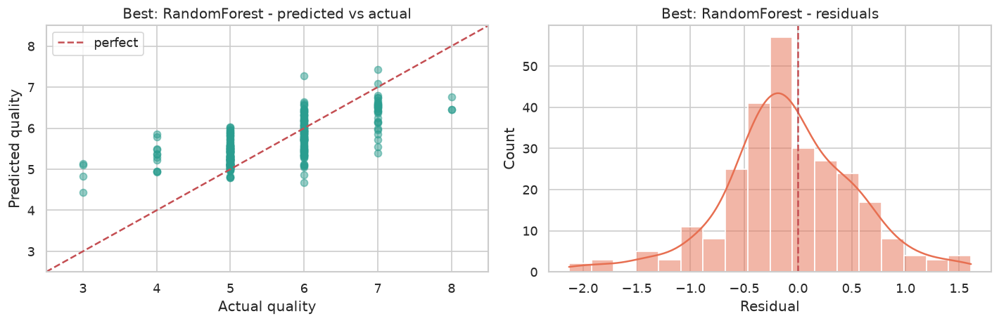
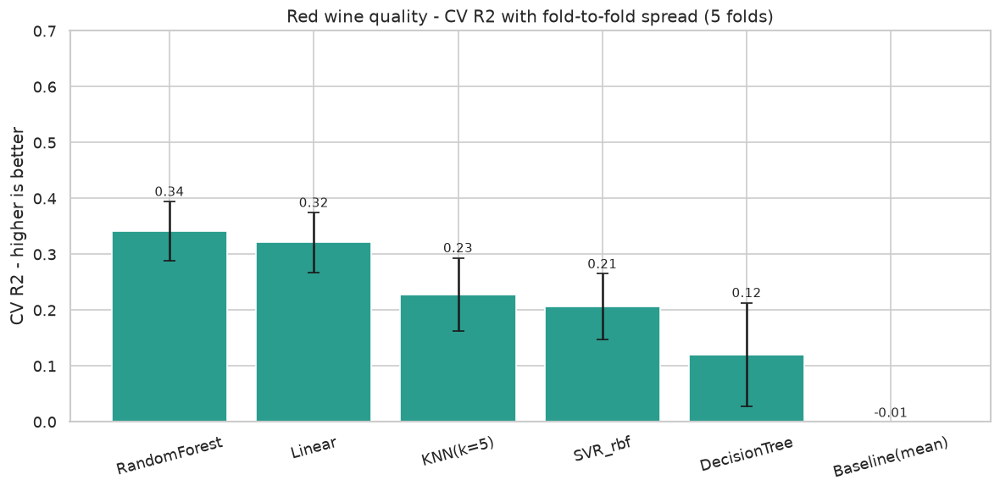

# Red Wine Quality Regression

This project builds and compares several machine learning regression models that predict the **quality score of a red wine** from its physicochemical measurements. The target is the `quality` column, a score assigned by wine tasters between 3 and 8.

It is a study, not a wine-tasting tool. The point is to see how different algorithms behave on the same small tabular dataset, and to build the comparison in a way that is fair and reproducible.

The workflow covers:

1. Loading the raw dataset and removing duplicate records
2. Checking missing values, odd measurements, skew and outliers
3. Exploring how the measurements relate to the quality score
4. Preparing one shared preprocessing pipeline for every model
5. Training five regression models plus a mean-prediction baseline
6. Evaluating with 5-fold cross validation and a held out test set
7. Comparing models on RMSE, MAE and R²
8. Looking at where the errors come from, not just which number is smallest

Preprocessing stays inside the machine learning `Pipeline`. The imputer and scaler are fitted only on the training fold, so information from the test set cannot leak into training.

## Observation

No single model wins everywhere, and the differences here are modest.

Linear Regression is the easiest to read and is close behind the leader. KNN is simple but depends heavily on scaling. SVR can bend to the data but needs tuning. The Decision Tree is easy to explain yet gives the noisiest predictions of the five. Random Forest led this run by averaging many trees, although its lead over Linear Regression is smaller than the fold-to-fold spread.

Every model clearly beats the mean-prediction baseline, which is the minimum bar worth clearing.

### Best Model: Random Forest

Random Forest reached approximately **CV RMSE 0.658**, **CV R² 0.342**, and **Test RMSE 0.618 / R² 0.460** on the held out set.



## Dataset

The data is the **Red Wine Quality** dataset that is hosted on Kaggle and originates from the **UCI Machine Learning Repository**. It comes from a study of Portuguese *Vinho Verde* wines, where physicochemical tests were recorded alongside sensory quality scores.

The Kaggle copy used here is:

https://www.kaggle.com/datasets/uciml/red-wine-quality-cortez-et-al-2009

The original study:

> P. Cortez, A. Cerdeira, F. Almeida, T. Matos and J. Reis, "Modeling wine preferences by data mining from physicochemical properties", Decision Support Systems, 47(4), 547-553, 2009.

The raw CSV lives untouched in `data/raw/red_wine_quality.csv`.

The original dataset has **1,599 records**. After removing **240 exact duplicates**, **1,359** unique wines remain. There are no missing values.

| Item | Count |
| ---- | ----: |
| Raw records | 1,599 |
| Duplicates removed | 240 |
| Unique records used | 1,359 |
| Features | 11 |
| Target | `quality` |

The target distribution after deduplication:

| Quality score | Wines |
| ------------ | ----: |
| 3 | 10 |
| 4 | 53 |
| 5 | 577 |
| 6 | 535 |
| 7 | 167 |
| 8 | 17 |
| Total | 1,359 |

Most wines sit at 5 or 6, so the scores are not evenly spread. The mean is about **5.62**.

### Features

| Feature | Description |
| ------- | ----------- |
| `fixed acidity` | Fixed acidity, mostly from non-volatile acids |
| `volatile acidity` | Volatile acidity; high values are linked to a vinegary taste |
| `citric acid` | Citric acid content |
| `residual sugar` | Sugar left after fermentation |
| `chlorides` | Salt content |
| `free sulfur dioxide` | Free SO2, used as a preservative |
| `total sulfur dioxide` | Total SO2, free plus bound |
| `density` | Density of the wine |
| `pH` | Acidity level on the pH scale |
| `sulphates` | Sulphate content |
| `alcohol` | Alcohol percentage by volume |
| `quality` | Sensory score from 3 to 8 (target) |

### Dataset Characteristics

This is a:

- Small dataset
- Tabular dataset
- Supervised regression problem
- Dataset with a discrete, ordinal-like target treated as a continuous number
- Dataset with duplicate records
- Dataset with strongly skewed measurements
- Dataset with correlated feature pairs

The quality score is an integer, but this project treats it as a continuous value to predict. That choice is discussed under Important Considerations.

## Why This Dataset Is Useful

It has several traits that show up in real tabular data:

- Duplicate records
- No missing values, which makes the imputer step a formality here
- Measurements on very different scales, from density near 1 to sulfur dioxide in the hundreds
- Right-skewed features such as residual sugar and chlorides
- Correlated pairs such as density/alcohol and free/total sulfur dioxide
- A target with limited range and a heavy concentration around two scores
- A small number of rows, which makes validation choices matter

These make it a useful setting for comparing models instead of training just one.

## Machine Learning Workflow

Every model goes through the same sequence:

```text
Raw Dataset
     ↓
Data Cleaning (duplicate removal only)
     ↓
Exploratory Data Analysis
     ↓
Train/Test Split
     ↓
Pipeline
     ├── Median Imputation
     ├── Standard Scaling
     └── Model
     ↓
5-Fold Cross Validation
     ↓
Test Set Evaluation
     ↓
Model Comparison
```

There is no resampling step. Unlike an imbalanced classification problem, regression on a numeric score has no minority class to oversample.

### Data Leakage Prevention

The imputer and scaler are inside the `Pipeline`, not applied to the whole table up front.

That means their medians, means and standard deviations are learned only from the training portion inside each cross validation fold. The test set stays unseen until the final evaluation.

The cleaned CSV in `data/processed/` is deduplicated only. No imputation or scaling is saved into it, so the notebooks can reload the same starting point.

## Models

### Mean Baseline

`DummyRegressor` always predicts the average quality score. It gives context: a model that cannot beat it has learned nothing useful.

### Linear Regression

A simple linear baseline with one coefficient per measurement. Alcohol gets a positive coefficient and volatile acidity a negative one, which matches the exploratory plots.

### Decision Tree

A set of nested threshold rules, capped at depth 6 so the first levels can still be drawn and read. It is interpretable but noisy on this data.

### K Nearest Neighbors

Predicts the average score of the five closest wines. Distances make the scaling step essential here.

### Support Vector Regression

An RBF kernel with `C=10` and `epsilon=0.1`. It can model curved relationships but needs more tuning than the linear model.

### Random Forest

Two hundred trees average their predictions. It gave the lowest cross validated error in this experiment.

## How to Run

### Option 1: UV Recommended

```bash
uv sync
uv run jupyter lab
```

### Option 2: PIP

```bash
pip install -r requirements.txt
jupyter lab
```

The project uses Python 3.14, matching the liver classification project in this repository. Open the notebooks in order:

```text
01 → 02 → 03 → 04
```

Notebook `03` trains every model with the same pipeline and split. Notebook `04` produces the final comparison.

## Notebook Structure

### `01_data_cleaning.ipynb`

Loads the raw CSV, inspects it, checks for impossible values, finds and removes the 240 duplicates, plots outlier boxplots, and measures correlation and variance inflation. It saves `data/processed/red_wine_cleaned.csv` and `data/outputs/cleaning_summary.json`.

The correlation check finds alcohol at about **+0.48** with quality and volatile acidity at about **-0.40**.

### `02_eda.ipynb`

Reloads the cleaned data and looks at:

- Quality score counts and average measurements per score
- Violin plots split into quality bands of 5 or less, 6, and 7 or more
- A pairplot of alcohol, volatile acidity, sulphates and density
- Mutual information ranking
- A demo of train-fitted IQR clipping bounds

Mutual information ranks alcohol first, then volatile acidity and sulphates.

### `03_models.ipynb`

Defines the shared pipeline, trains the baseline and five models, cross validates each one with `KFold(5, shuffle=True, random_state=42)`, and evaluates on the held out 20%. Each model gets a predicted-vs-actual plot and a residual histogram. The notebook also prints linear coefficients and Random Forest feature importances, then saves `data/outputs/baseline_comparison.csv` and the best-model image.

### `04_model_comparison.ipynb`

Loads the summary CSV and compares models on cross validated R² with fold spread, CV versus test R², and when each model is worth picking. It saves `data/outputs/comparison.csv` and `assets/images/model_comparison.png`.

## Project Structure

```text
data/
  raw/
    red_wine_quality.csv
  processed/
    red_wine_cleaned.csv
  outputs/
    cleaning_summary.json
    baseline_comparison.csv
    comparison.csv

assets/images/
  best_model.png
  model_comparison.png

notebooks/
  01_data_cleaning.ipynb
  02_eda.ipynb
  03_models.ipynb
  04_model_comparison.ipynb

src/
  red_wine_quality_regression/
```

The raw dataset is never overwritten. Processed data and model outputs are kept in separate folders so the run can be reproduced from the original file.

## Results

| Model | CV RMSE | CV R² | Test RMSE | Test R² |
| ----- | ------: | ----: | --------: | ------: |
| Random Forest | 0.658 | 0.342 | 0.618 | 0.460 |
| Linear Regression | 0.668 | 0.321 | 0.657 | 0.392 |
| KNN (k=5) | 0.713 | 0.228 | 0.713 | 0.283 |
| SVR (RBF) | 0.723 | 0.206 | 0.692 | 0.323 |
| Decision Tree | 0.760 | 0.121 | 0.671 | 0.364 |
| Mean baseline | 0.818 | -0.011 | 0.844 | -0.006 |

Lower RMSE is better; higher R² is better. Test numbers come from one split and are more optimistic than the cross validated numbers for most models.

## Model Comparison



Random Forest has the tallest bar, but the error bars overlap with Linear Regression. In practice the linear model is a reasonable choice when reading the direction of each effect matters more than a small gain in accuracy.

| Model | Main Strength | Main Limitation |
| ----- | ------------- | --------------- |
| Linear Regression | Simple and readable | Misses nonlinear effects |
| Decision Tree | Easy to explain | High variance between folds |
| KNN | Intuitive | Sensitive to scaling and feature count |
| SVR | Flexible boundary | Needs tuning |
| Random Forest | Lowest error and stable | Harder to read than one tree |

## Important Considerations

This is a machine learning study, not a system for grading wine.

The sensory scores are integers from 3 to 8, and there are only about 1,360 unique wines. Treating the score as continuous is a practical choice for regression, but it does assume that the gap between 5 and 6 is comparable to the gap between 7 and 8. An ordinal model could be a better fit for the target.

The dataset is dominated by scores 5 and 6, so a model can look reasonable while still missing the rare low and high scores. The R² values are modest, which is expected when people assign the scores and the measurements explain only part of the preference.

The duplicate records were removed because identical rows in both train and test would inflate the results. We kept the 240 duplicates out of the cleaned file and logged the count in `cleaning_summary.json`.

## What Could Have Been Improved

### 1. Data and Validation

- **Small dataset:** 1,359 unique rows means performance moves noticeably between splits. Repeated cross validation would give a tighter estimate.
- **Single train/test split:** Repeated or nested cross validation would make the test numbers less dependent on one random seed.
- **External validation:** The model has not been tried on a different set of wines.

### 2. Preprocessing

- **Skewed features:** Residual sugar, chlorides and sulfur dioxide have long tails. Robust scaling or a train-fitted log transform could be tested inside the pipeline.
- **Outlier handling:** IQR clipping was demonstrated in `02` but not applied. It could be added as a pipeline step.
- **Correlated pairs:** Density/alcohol and free/total sulfur dioxide overlap in information. Dropping one of each could be compared against keeping them.

### 3. Target Handling

- **Ordinal nature of quality:** An ordinal regression approach, or treating the problem as classification, may describe the score better than plain regression.
- **Rare scores:** Scores 3 and 8 have very few examples, so errors there are hard to learn from.
- **Score rounding:** Predictions could be rounded to whole points and checked against the original scale.

### 4. Model Tuning

- **Limited hyperparameter search:** `GridSearchCV` or `RandomizedSearchCV` could improve SVR, KNN and the tree models.
- **Limited model set:** Gradient boosting methods such as XGBoost or LightGBM were not compared.
- **No learning curves:** Training and validation curves would show whether more data would help.

### 5. Evaluation

- **RMSE and R² only:** MAE is reported, but per-score error and confusion between neighbouring scores were not analysed.
- **Residual analysis:** The residual plots in `03` show where models miss, but the largest errors were not inspected individually.
- **Interpretability:** Permutation importance or SHAP could add detail beyond the built-in feature importances.
